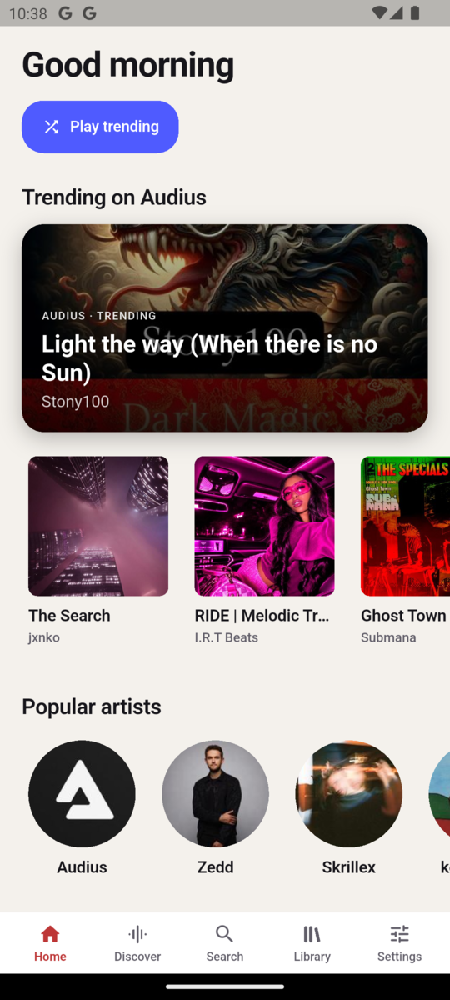
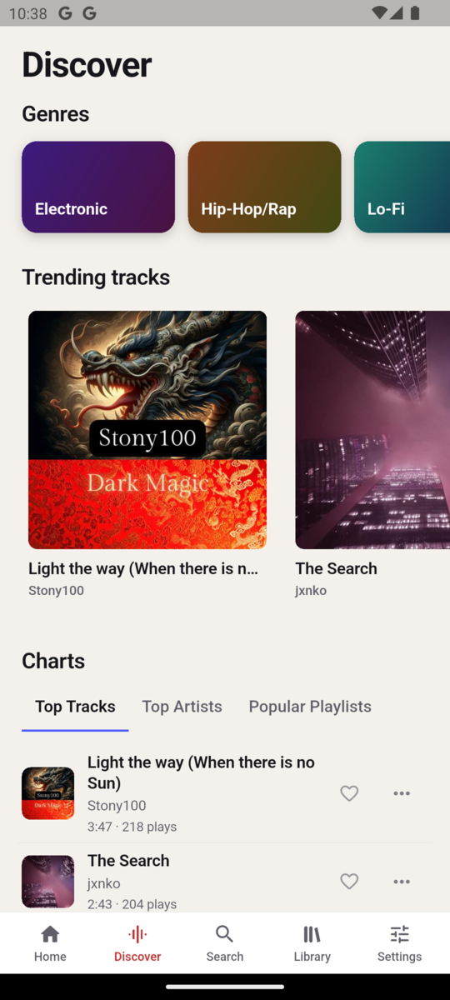
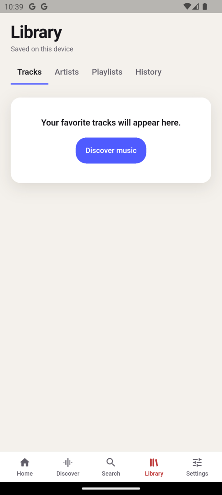

<p align="center">
  
</p>

<h1 align="center">AudiFi</h1>

<p align="center">
  <strong>An independent music client powered by Audius.</strong><br />
  Discover, stream, and collect music through the decentralized Audius protocol.
</p>

<p align="center">
  <a href="#about">About</a> &bull;
  <a href="#screenshots">Screenshots</a> &bull;
  <a href="#features">Features</a> &bull;
  <a href="#technology">Technology</a> &bull;
  <a href="#privacy--data-handling">Privacy</a> &bull;
  <a href="#audius-attribution">Attribution</a> &bull;
  <a href="#getting-started">Getting Started</a>
</p>

---

## About

AudiFi is an independent, local-first music application built with Flutter for discovering and streaming music through the public [Audius](https://audius.co) protocol. Engineered with an emphasis on speed, refined typography, and responsive audio playback, AudiFi lets you explore trending charts, stream independent artists, manage custom playlists, and import local audio files&mdash;with zero account requirements, zero subscriptions, and zero tracking.

## Screenshots

<p align="center">
  
  &nbsp;
  
  &nbsp;
  
  &nbsp;
  
</p>

<p align="center">
  <em>From left to right: Home recommendations, Discover charts, Now Playing player, and Local Library.</em>
</p>

## Features

- **Decentralized Music Discovery** &mdash; Stream trending releases, top playlists, and underground tracks directly from public Audius discovery nodes.
- **Instant Search** &mdash; Search across tracks, artists, albums, and playlists with local search history.
- **Personal Library** &mdash; Save liked tracks, follow artists, save playlists, and organize custom local playlists.
- **Robust Audio Engine** &mdash; Continuous background playback, system lock-screen controls, interactive scrubber, loop/shuffle modes, and predictive next-track stream pre-resolution.
- **Local Audio Imports** &mdash; Import and play audio files (`.mp3`, `.m4a`, `.flac`, `.wav`, `.aac`, `.ogg`) stored on your device alongside streaming music.
- **Offline Downloads** &mdash; Download creator-authorized tracks to local device storage for offline playback.
- **Sleep Timer & Controls** &mdash; Schedule automatic playback shutdown (15 to 60 minutes or end of track) and pause automatically when headphones disconnect.
- **Appearance Customization** &mdash; Tailored themes for Dark, Light, and OLED Pure Black modes, configurable accent colors, and system-reduced motion support.

## Technology

AudiFi is designed around clean, testable architecture and efficient audio stream processing:

- **Framework**: [Flutter](https://flutter.dev) & [Dart](https://dart.dev)
- **Architecture**: Layered Clean Architecture (Presentation, Domain, Data)
- **State Management**: [Riverpod](https://riverpod.dev) (`flutter_riverpod`)
- **Navigation**: [GoRouter](https://pub.dev/packages/go_router) with declarative routing
- **Audio Engine**: [just_audio](https://pub.dev/packages/just_audio) & [audio_service](https://pub.dev/packages/audio_service) for native background playback
- **Networking**: [Dio](https://pub.dev/packages/dio) with Audius REST API and public gateway resolution
- **Local Storage**: `shared_preferences` for on-device metadata and app-sandboxed audio storage

## Privacy & Data Handling

AudiFi is built on a guest-first, privacy-respecting model:

- **No Account Required** &mdash; AudiFi does not require user registration, logins, or authentication.
- **On-Device Data Storage** &mdash; Favorites, playlists, listening history, search history, and imported files stay strictly on your device.
- **No Analytics or Telemetry** &mdash; The application contains zero advertising frameworks, third-party analytics SDKs, or background trackers.
- **Network Transparency** &mdash; Network requests are made solely to public Audius discovery nodes to fetch catalog metadata and stream audio content.

## Audius Attribution

AudiFi is an independent third-party client. It is not created by, affiliated with, sponsored by, or endorsed by Audius. All artist content, metadata, and audio streams are provided through the public, decentralized [Audius](https://audius.co) protocol.

## Getting Started

To build and run AudiFi locally from source:

### Prerequisites

- [Flutter SDK](https://docs.flutter.dev/get-started/install) (3.14.0+ / Dart 3.14.0+)
- Android Studio / Xcode (for mobile deployment)

### Build & Run

```bash
# Clone the repository
git clone https://github.com/your-username/audifi.git
cd audifi

# Install dependencies
flutter pub get

# Run the app in debug mode
flutter run
```

### Running Tests & Analysis

```bash
# Run full unit and widget test suite
flutter test

# Run static analysis
flutter analyze
```

## Status & License

AudiFi is currently a pre-publication project in active development. Official release packaging, distribution channels, and licensing terms are being finalized.
